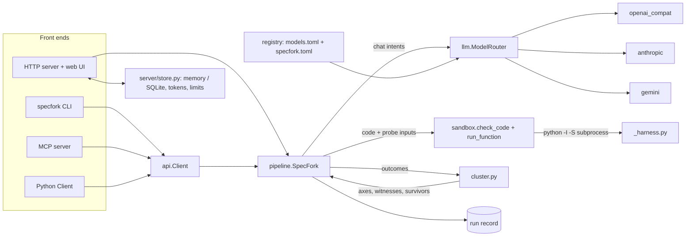
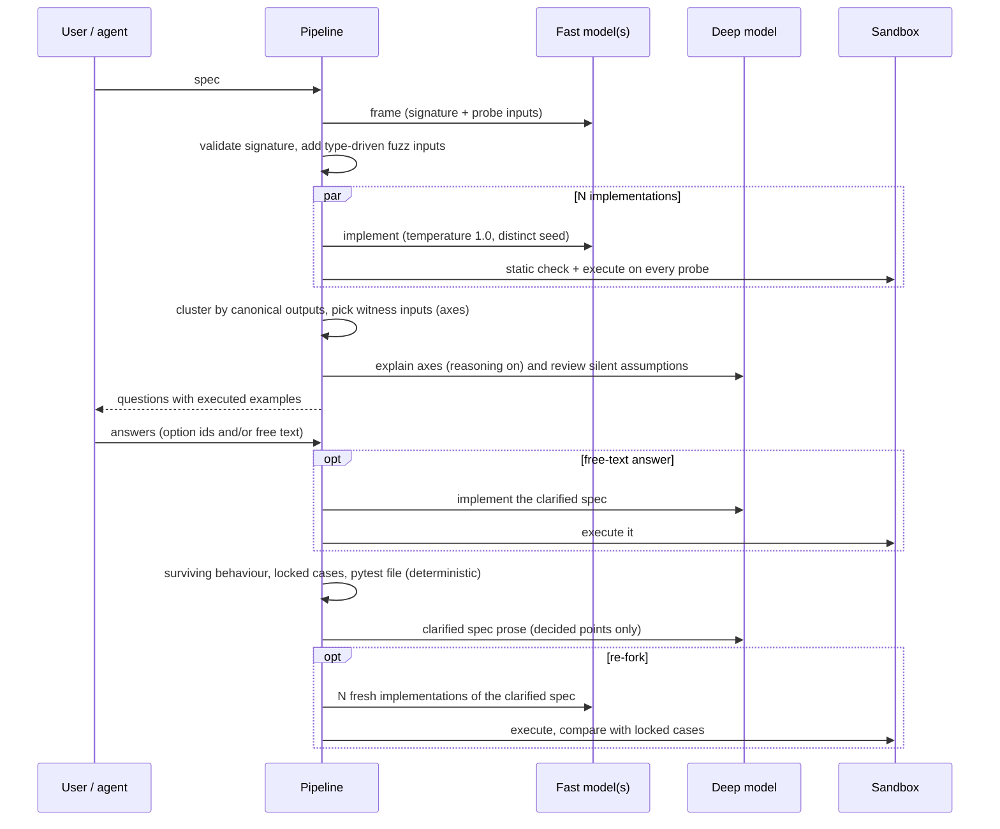

# Architecture

SpecFork is one engine with four front ends: a CLI, an MCP server, a Python library and an HTTP server with
a web UI. All of them go through `specfork.api.Client` (or, in the HTTP server, the same `SpecFork` engine
and `ModelRouter`), so a run behaves the same wherever it starts.

## Module map

| Module | Responsibility |
|---|---|
| `specfork/__init__.py` | public API: `Client`, `ForkError`, `Run`, `Question`, `__version__`; no side effects on import |
| `specfork/api.py` | `Client`: builds settings, registry, router and engine; `fork`, `resolve`, `converge`, `tests` |
| `specfork/config.py` | `Settings` (pydantic-settings): every environment variable in one place, read once by `Settings.load()` |
| `specfork/registry.py` + `models.toml` | model profiles as data (`ModelProfile`, `Registry`); user profiles from `specfork.toml` |
| `specfork/llm.py` | `ModelRouter` and the three adapters (`openai_compat`, `anthropic`, `gemini`); retries, concurrency, call records, cost; `extract_json` |
| `specfork/pipeline.py` | `SpecFork` engine: frame → fan-out → execute → cluster → explain (+ silent assumptions) → resolve → converge; `new_run`, `render_tests` |
| `specfork/prompts.py` | prompt templates, `PROMPT_VERSION` and `prompt_hash()` (stored with every run) |
| `specfork/cluster.py` | pure functions: behavioural clustering, witness/axis selection, surviving clusters, agreement, compatible options |
| `specfork/canon.py` | canonical value representation used for comparing outputs (3 vs 3.0, tuple vs list, …) |
| `specfork/sandbox.py` | static AST allow-list (`check_code`) and isolated execution (`run_function`, `selftest`) |
| `specfork/_harness.py` | the child-process harness (runs under `python -I -S`; imports nothing from `specfork`) |
| `specfork/types.py` | Pydantic views of a run (`Run`, `Question`, `Option`, `Resolution`, …); unknown fields are kept |
| `specfork/presets.py` | one-click example specs for the UI |
| `specfork/samples/*.json` | recorded sample runs shown by the web UI |
| `specfork/cli.py` | `specfork` console script: `fork`, `resolve`, `doctor`, `serve`, `mcp` |
| `specfork/mcp_server.py` | MCP server (stdio) with six tools |
| `specfork/server/main.py` | FastAPI app factory `create_app`, HTTP routes, SSE, security headers, exports |
| `specfork/server/store.py` | `RunStore` (memory, optionally SQLite), capability tokens, `RateLimiter` (rate limit + daily spend cap) |
| `web/` | React + TypeScript + Tailwind frontend (built into `web/dist`, served by the HTTP server) |
| `tests/` | offline tests; `tests/fake_llm.py` is a scripted fake model |
| `evals/` | benchmark specs with hidden references and the live evaluation runner |

## Data flow

Stage by stage:

## The run record

A run is a plain JSON-serialisable dict (`pipeline.new_run`), typed by `specfork.types.Run`. It is what the
CLI prints with `--json`, what `specfork resolve` reads back, what the HTTP API returns and what the SQLite
store persists.

| Field | Contents |
|---|---|
| `id`, `created_at`, `updated_at` | identity and timestamps |
| `status` | `running` → `awaiting_answers` → `resolving` → `resolved` (→ `converging` → `resolved`), or `error` |
| `stage` | current pipeline stage (`frame`, `fanout`, `execute`, `cluster`, `explain`, `done`) |
| `spec` | the original spec text |
| `settings` | `n_samples`, `fast_model`, `deep_model`, `implementers` (model ids), `assumptions`, `prompt_version`, `prompt_hash` |
| `signature` | function name, typed params, return type |
| `inputs` | probe inputs `i0…`, each with `args`, `source` (`model` or `fuzz`) and a note |
| `implementations` | `m0…` (fan-out), `u0`/`u1` (free-text answer), each with `model`, `status` (`executed`, `rejected`, `error`), `code`, `outcomes`, `cluster_id` |
| `clusters` | behaviours `A, B, …` with `impl_ids`, `size`, `share`, `representative_impl_id`, `kind` (`behavior` or `crash`), model-written `summary` |
| `questions` | `q<k>` (`ambiguity` or `likely_bug`) and `a<k>` (`assumption`), each with `witness_input_ids` and `options` (`cluster_ids`, `impl_count`, executed `examples`; `is_alternative` for a proposed, unexecuted alternative; `is_custom` for a free-text answer) |
| `resolution` | `answers`, `surviving_cluster_ids`, `clarified_spec`, `decisions`, `locked_cases` (with `basis`: `decided` or `consensus`), `open_input_ids`, `unlocked_input_ids`, `tests_code`, `reference_code`, `agreement_before`, `convergence` |
| `trace` | one record per model call: purpose, model, thinking, latency, tokens, cost, request id, reasoning excerpt |
| `metrics` | totals: cost, tokens, calls, wall time |
| `log` | human-readable progress lines per stage |

The HTTP server also produces a compact **decision record** from a resolved run
(`GET /api/runs/{id}/export.json`): SpecFork version, spec, clarified spec, signature, decisions,
locked cases, agreement before/after, models, prompt version and hash. It is meant to be committed next to
the code (for example as `.specfork.json`).

## HTTP API

`create_app(settings=None, router=None, web_dist=None)` builds the FastAPI app (`specfork serve`, or
`uvicorn --factory specfork.server.main:create_app`). Outside public-demo mode the OpenAPI schema is at
`/openapi.json` and Swagger UI at `/docs`.

| Method and path | Purpose |
|---|---|
| `GET /api/health` | version, configured models and labels, models a visitor may choose, public-demo flag, sandbox status (`ok`, `net_isolated`) |
| `GET /api/presets` | example specs, with the id of a recorded sample run when there is one |
| `GET /api/runs?ids=a,b` | recorded samples plus the runs whose ids the caller passes (other visitors' runs are never listed) |
| `POST /api/runs` | `{spec, n_samples?, preset_id?, fast_model?, deep_model?, assumptions?}` → `{id, token}` |
| `GET /api/runs/{id}` | the run record |
| `GET /api/runs/{id}/events` | server-sent events: `snapshot` (the run) and `end` |
| `POST /api/runs/{id}/answers` | `{answers: {qid: option_id}, other: {qid: text}}`, header `X-Run-Token` |
| `POST /api/runs/{id}/converge` | `{n_samples?}`, header `X-Run-Token`: the re-fork |
| `GET /api/runs/{id}/tests.py?module=pkg.mod` | pytest file importing the function from `module` (default `solution`) |
| `GET /api/runs/{id}/export.md` | Markdown bundle: specs, decisions, evidence, reference implementation, tests |
| `GET /api/runs/{id}/export.json` | the JSON decision record described above |

The `token` returned by `POST /api/runs` is a capability: only a caller holding it may answer or re-fork
the run. The store keeps only its SHA-256 digest.

## Determinism boundary

| Decided by code (deterministic, testable offline) | Written by a model |
|---|---|
| validity of the signature and of every probe input (identifier and size checks) | the proposed signature and probe inputs |
| type-driven fuzz inputs (seeded from the spec hash) | implementations (fan-out, re-fork, free-text answers) |
| whether code is allowed to run (AST allow-list) and what it returns (sandbox) | question text, "why it matters", option labels |
| canonical comparison of outputs, behaviour clusters | cluster summaries |
| witness inputs and axes of disagreement (greedy pair separation) | likely-bug labels (accepted only for groups under 25% of implementations) |
| which assumption questions are kept (confidence ≥ 0.6, at most 2, backed by an executed probe) | candidate silent assumptions and alternative labels |
| which answers are compatible, which behaviour survives | the clarified spec prose (decided points only) |
| locked test cases: decided witnesses plus inputs where ≥ 75% of implementations agreed | — |
| the pytest file (`render_tests`) and its expected values | — |
| agreement before and after the re-fork | — |

When a model call that only explains fails (explainer, assumption review, clarifier), the pipeline degrades
instead of failing: raw witness questions, no assumption questions, or the original spec with the decisions
appended verbatim.

## Plug-in points

| Extension | Where | How |
|---|---|---|
| Model profiles | `specfork.toml` (or `SPECFORK_MODELS_FILE`) | add `[models.<key>]` entries; see [PROVIDERS.md](PROVIDERS.md) |
| Model adapters | `specfork/llm.py: ADAPTERS` | a `(build, parse)` pair per `api` value; add the value to `registry.APIS` |
| Reasoning modes | `_openai_build` / `_anthropic_build` / `_gemini_build` | add a value to `registry.REASONING` and translate it in the adapter |
| Sandbox | `specfork/sandbox.py`, `_harness.py` | `configure(require_isolation, concurrency)`; allow-list in `ALLOWED_IMPORTS` / `BANNED_*` (security-sensitive: see [SECURITY.md](SECURITY.md)) |
| Presets | `specfork/presets.py` | append to `PRESETS`; record a sample run into `specfork/samples/` with `scripts/make_samples.py` |
| Store | `specfork/server/store.py: RunStore` | memory by default, SQLite via `SPECFORK_DB`; replace the class to use another backend (`get`, `add`, `touch`, `persist`, `set_token`, `check_token`, `event`, `recent`) |
| Front end | `specfork.api.Client` | any program can drive the engine; the CLI and MCP server are thin wrappers |

## Extension recipes

**Use a different model for the fan-out only.** Add a profile to `specfork.toml` and set
`SPECFORK_IMPLEMENTERS=lightning,my-model`. Implementations are assigned round-robin (`m0` to the first
key, `m1` to the second, …); the re-fork uses the same list.

**Add a provider with a new wire format.** Write `_x_build(profile, key, messages, *, thinking, effort,
temperature, max_tokens, seed, json_mode) -> (url, headers, body)` and `_x_parse(data) -> (content,
reasoning, prompt_tokens, completion_tokens, request_id, tool_calls)`, register them in `ADAPTERS`, add the
name to `registry.APIS`, and cover the request/response shapes with a test that uses a fake HTTP transport
(see `tests/test_llm.py`).

**Run SpecFork in CI.** `specfork fork --auto --refork --json --out tests/ "<spec>"` answers every question
with the most common compatible behaviour and writes the pytest file; or keep a reviewed `answers.json`
and use `specfork resolve run.json --answers answers.json`. See [CLI_AND_MCP.md](CLI_AND_MCP.md).

**Drive it from your own program.** Use `Client.fork`, `Client.resolve`, `Client.converge` and
`Client.tests`; pass `signature={...}` to `Client.new_run` / `fork` to fix the function signature instead
of letting the model frame it.

**Store runs elsewhere.** Implement the `RunStore` methods listed above and construct the app with it
(the store is created inside `create_app`; a custom backend currently means a small change there).
